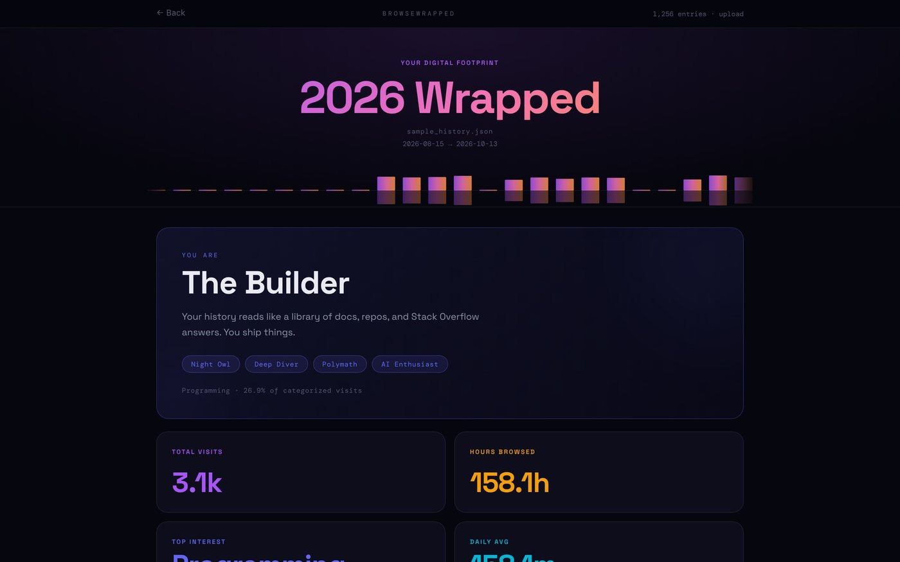
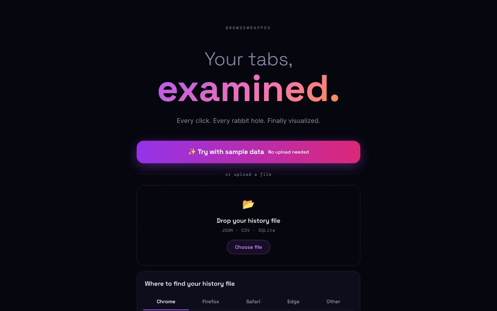
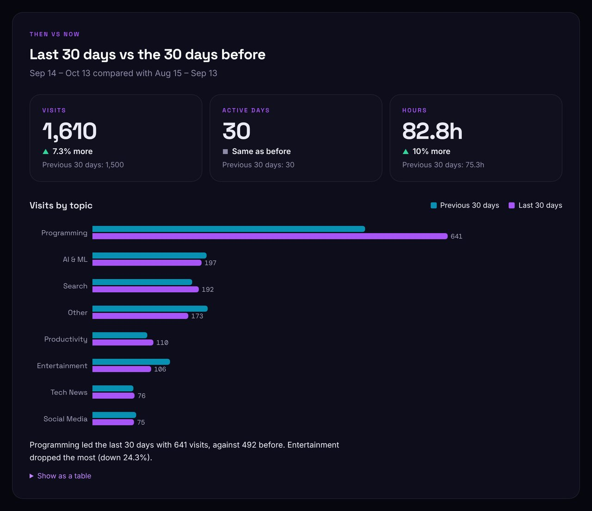
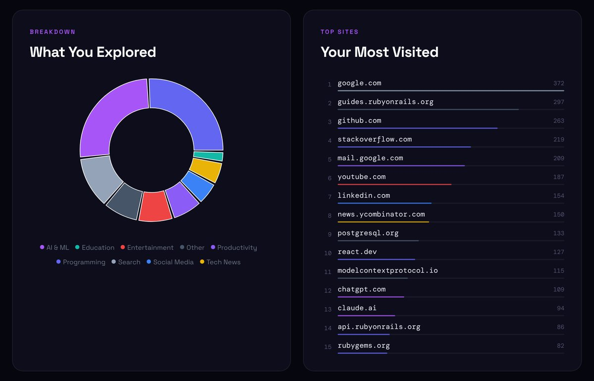
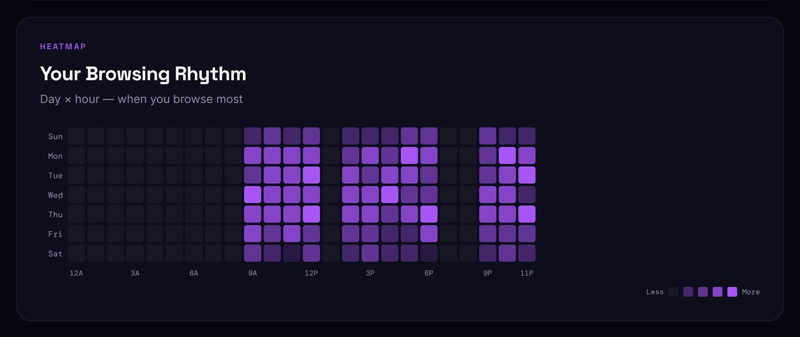
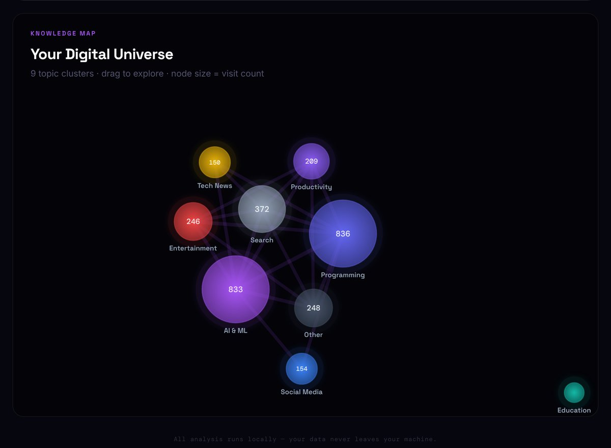
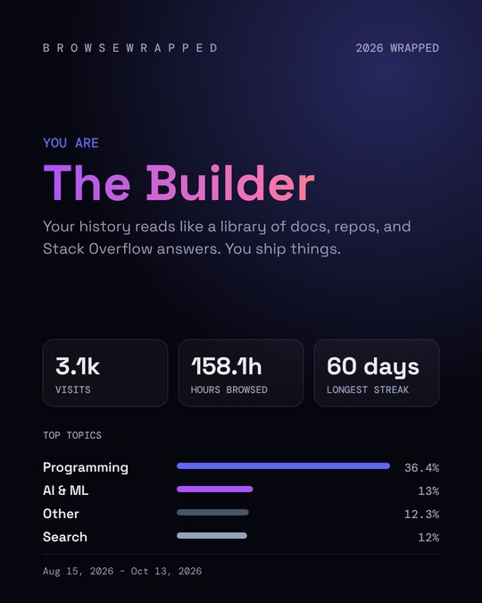
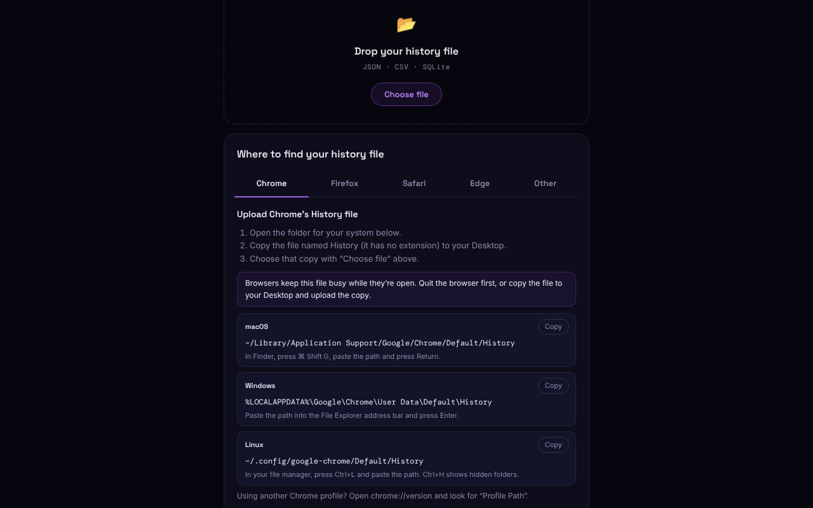
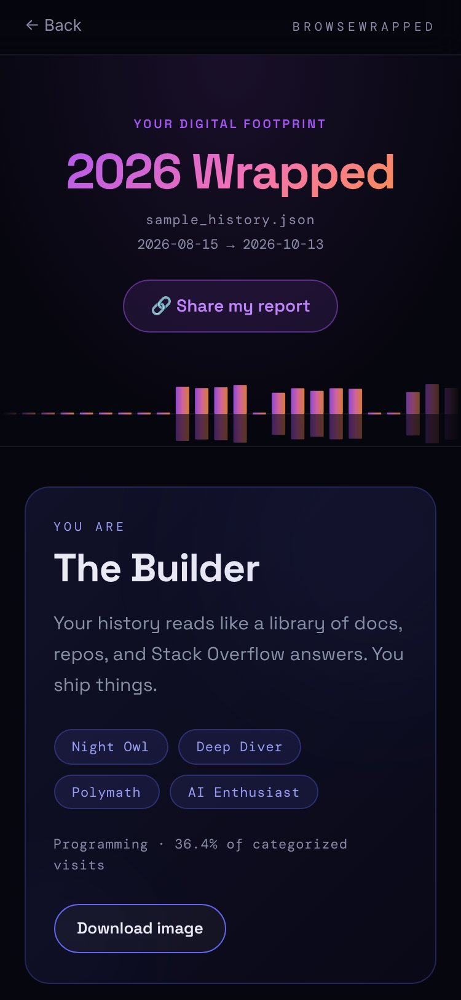

# BrowseWrapped Web

[](https://github.com/MeghaKoshti/browsewrapped-web/actions/workflows/ci.yml)

**BrowseWrapped turns your browser history into a "Spotify Wrapped"-style report**: what you explored, when you browse, which topics are growing, and a knowledge map of your interests.

This repo is the **React frontend**. The analysis happens in the Rails API: [browsewrapped-api](https://github.com/MeghaKoshti/browsewrapped-api). For how the pieces fit together and why, see [Architecture & decisions](https://github.com/MeghaKoshti/browsewrapped-api#architecture--decisions).



## Screenshots

| Upload | Then vs now |
|---|---|
|  |  |
| **What you explored** | **Browsing rhythm (day × hour heatmap)** |
|  |  |
| **Knowledge map** | **Persona card (downloaded PNG)** |
|  |  |
| **Export guide** | **Mobile (375 px)** |
|  |  |

> Screenshots use the synthetic sample file from the API repo (`sample/sample_history.json`), not real browsing data.

## Features

- **Try with sample data:** one click shows a full report from a synthetic history, no export needed
- **Upload or import:** drop a Chrome Takeout JSON, an extension export (JSON or CSV), or the browser's own SQLite history database: Chrome/Edge `History`, Firefox `places.sqlite` or Safari `History.db` (the file picker has no extension filter, so the extensionless `History` file can be chosen). When the API runs on your own machine, "Import from Chrome" reads Chrome's database directly
- **Export guide:** step-by-step tabs for Chrome, Firefox, Safari, Edge and other browsers, with file locations on macOS, Windows and Linux and a one-click copy for each path. It opens on the visitor's own browser
- **Persona card:** a fun "you are…" summary (The Builder, The AI Pioneer…) based on your top topics
- **Download image:** save your persona card as a 1080×1350 PNG (persona, top topics, key stats), made in your browser
- **Stats:** total visits, hours browsed, daily average, top interest, streaks
- **Charts:** topic breakdown, most-visited sites and pages, activity calendar, day × hour heatmap, weekly and monthly patterns
- **Trends:** which interests are rising or falling, and how your curiosity shifted over time
- **Then vs now:** your latest 30 days against the 30 before (visits, active days, hours and topics), with a text summary and table view of the chart
- **Knowledge map:** an interactive graph of topic clusters (drag to explore)
- **Large files:** big uploads are analysed in the background; `/analyses/:id` shows a processing screen and polls until the report is ready
- **Delete my data now:** the report page has a "Delete this report now" button that removes the stored analysis from the API straight away (it uses the one-time delete token from the upload, kept in `sessionStorage` for that tab)
- **Share links:** "Share my report" creates a public `/r/:token` page with aggregated stats only (no URLs, titles, searches or site names), which you can delete at any time
- **Accessible and responsive:** works from 375 px phones up, keyboard friendly (skip link, visible focus), WCAG AA contrast, and every chart has a text alternative
- **Friendly errors:** unsupported or empty files, databases that aren't browser history or were copied half-written, oversized uploads and rate limits (with the real wait from `Retry-After`) get a plain-English message instead of a crash
- **Ready to deploy:** Vercel config with SPA rewrites, a strict Content Security Policy and security headers; the API URL comes from `VITE_API_URL`, and report pages and charts load as separate chunks
- **Tested:** Vitest + React Testing Library suite (pages, period comparison, persona image, error copy, skip link), run with lint and the build in CI

## Privacy

What the upload page tells visitors, and what actually happens:

- **The uploaded file** is read on the API server and deleted as soon as it has been analysed.
- **The report** (totals, topics, top sites, top pages with address and title, and top searches) is kept for **7 days** so the visitor can reopen `/analyses/:id`, then a daily job deletes it.
- **Delete now:** the upload response carries a one-time `delete_token`. The web app keeps it in `sessionStorage` (`bw.deleteTokens`, a map of analysis id to token) and sends it as `X-Delete-Token` to `DELETE /api/v1/analyses/:id`. Only the tab that uploaded the file can delete it early.
- **AI categorisation:** up to 50 domain names the rules don't recognise (for example `example.com`) may be sent to Google Gemini. Never full URLs, page titles or searches.
- **Share links** contain aggregated stats and topics only and expire after 30 days.

## Tech stack

- React 19 + Vite
- Tailwind CSS 4 (CSS-first config in `src/index.css`, via `@tailwindcss/vite`)
- Recharts for charts, D3 for the force-directed knowledge map
- Axios for API calls
- Vercel for hosting (SPA rewrites and security headers in `vercel.json`)
- React Router

## Getting started

### 1. Start the API

Follow the setup in [browsewrapped-api](https://github.com/MeghaKoshti/browsewrapped-api) and run it on `http://localhost:3000`.

### 2. Start the frontend

```bash
npm install
npm run dev
```

Open http://localhost:5173. The Vite dev server proxies `/api` requests to `http://localhost:3000` (see `vite.config.js`).

### 3. Try it

Upload `sample/sample_history.json` from the API repo, or your own history. The upload page has a guide for every browser; in short:

- **Chrome / Edge:** the `History` file in your profile folder (no extension), or a [Google Takeout](https://takeout.google.com) export
- **Firefox:** `places.sqlite` in your profile folder (open `about:support` → Profile Folder)
- **Safari:** `~/Library/Safari/History.db`
- **Any browser:** a CSV or JSON file from a history-export extension

Browsers keep their history database busy while they're open, so quit the browser or upload a copy of the file.

### Test

```bash
npm test          # run the Vitest + React Testing Library suite once
npm run test:watch
```

Tests run in jsdom with the API client mocked, so no API server is needed. CI runs lint, tests and the build on every pull request.

### Build

```bash
npm run build
```

## Deploy

The frontend is a static site, set up for [Vercel](https://vercel.com). The API deploys separately (see [browsewrapped-api](https://github.com/MeghaKoshti/browsewrapped-api#deploy-flyio)).

1. **Import the repo in Vercel.** It detects Vite: build command `npm run build`, output directory `dist`.
2. **Set `VITE_API_URL`** under Project → Settings → Environment Variables, for example `https://browsewrapped-api-<you>.fly.dev`. It is read at build time, so redeploy after changing it. Without it the app calls `/api` on its own origin, which only works with the Vite dev proxy. See `.env.example`.
3. **Put the API origin in the CSP.** In `vercel.json`, replace `https://browsewrapped-api-CHANGE-ME.fly.dev` in `connect-src` with your API's origin (scheme and host only, no path). Until you do, the browser blocks every API call.
4. **Allow the web app on the API.** Set `CORS_ORIGINS=https://<your-app>.vercel.app` on the API. It already exposes `Retry-After`, so rate-limit messages show the real wait.

What `vercel.json` sets up:

- **Deep links:** every path except `/api/*` falls back to `index.html`, so `/r/:token` and `/analyses/:id` links open directly.
- **Security headers:** a Content Security Policy (only this site's scripts and styles, Google Fonts, the API in `connect-src`, `data:`/`blob:` images for the PNG export, no framing), `X-Content-Type-Options: nosniff`, `Referrer-Policy: strict-origin-when-cross-origin` and a `Permissions-Policy` that turns off camera, microphone and location.
- **Caching:** hashed files in `/assets/` are cached for a year.

"Import from Chrome" reads Chrome's database on the machine the API runs on, so the upload page only shows it when `VITE_API_URL` is empty or points at `localhost`. Visitors to the hosted site upload their history file instead.

The CSP needs no `'unsafe-inline'`: styles live in `src/index.css`, and React and D3 set inline styles through the DOM, which CSP allows. Keep new `<style>` tags out of components.

To check a production build locally:

```bash
VITE_API_URL=https://browsewrapped-api-<you>.fly.dev npm run build
npx vite preview   # http://localhost:4173
```

The report pages, Recharts and D3 are split into separate chunks that load on demand, so the upload page only downloads about 300 kB of JavaScript (about 100 kB gzipped).

## Project status

🚧 Actively in development. Ideas on the list: year-over-year comparison and more browser import options.

## Author

**Megha Koshti**, Ruby on Rails developer · [GitHub](https://github.com/MeghaKoshti) · [LinkedIn](https://www.linkedin.com/in/megha-koshti)

## License

[MIT](LICENSE)
